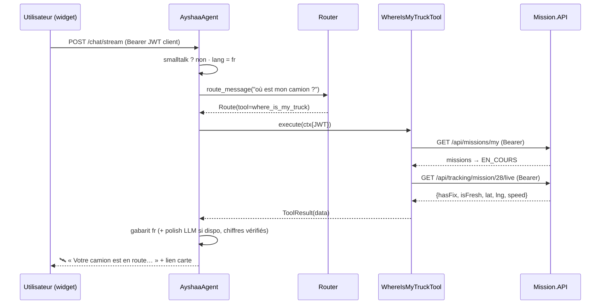

# Architecture de l'agent Ayshaa — LLM + RAG + Tool Calling

> Ayshaa n'est plus un chatbot RAG : c'est un **agent IA**, une « employée
> virtuelle » de XPARK qui comprend, va chercher la bonne information au bon
> endroit (connaissances OU données vivantes), agit via les APIs, et répond
> dans la langue de l'utilisateur.

## Vue d'ensemble

```text
                        Ayshaa AI Agent  (app/agent/orchestrator.py)
                                    │
                 ┌──────────────────┼──────────────────────┐
                 │                  │                      │
                 ▼                  ▼                      ▼
               LLM                RAG                Tool Calling
        (Ollama qwen2.5,     (Qdrant + BM25,        (app/tools/*)
         repli extractif)     fusion RRF)                 │
                                    │      ┌──────────┬───┴──────┬───────────┬──────────┐
                                    │      ▼          ▼          ▼           ▼          ▼
                                    │   IAM API   Mission API  Tracking   Pricing AI  Fleet API
                                    │   :iam-api  :mission-api (Mission)  :ai-predictor :fleet-api
                                    ▼
                            knowledge/ (18 documents trilingues)
```

## Le flux d'un message (`AyshaaAgent.answer`)

1. **Small talk** (`agent/smalltalk.py`) — « bonjour », « merci », « ça va ? »
   reçoivent une réponse de persona, jamais un passage documentaire.
2. **Détection de langue** (`agent/language.py`) — fr / en / darija, par
   message : si l'utilisateur change de langue en cours de conversation,
   Ayshaa suit immédiatement.
3. **Routage d'intention** (`agent/router.py`) — décide qui répond :
   - **Motifs déterministes trilingues** (priorité 1) : instantanés, testés,
     fonctionnent sans LLM. Ex. « où est mon camion » / « where is my truck »
     / « win el camion » → outil `where_is_my_truck`.
   - **Classification LLM** (priorité 2, si Ollama disponible) : un appel JSON
     court pour les formulations libres.
   - **RAG** (défaut) : le seuil de confiance du retrieval donne déjà un
     « je ne sais pas » honnête → jamais d'hallucination.
4. **Exécution** :
   - Route *tool* → `ToolRegistry.execute` (JWT de l'utilisateur transmis,
     RBAC = celui des APIs) → mise en mots par gabarits trilingues
     (`prompts/tool_answers.py`) → reformulation LLM optionnelle avec
     garde-fou (les chiffres du gabarit doivent survivre, sinon on garde le
     gabarit).
   - Route *rag* → pipeline historique inchangé (`rag/pipeline.py`).
5. **Mémoire** (`memory/store.py`) — chaque échange rejoint la session SQLite
   (fenêtre glissante de 8 tours envoyée au LLM, TTL 24 h).

## Qui répond à quoi (exemples réels)

| Message | Route | Répondant |
|---|---|---|
| « Bonjour ! » | smalltalk | persona |
| « Quels services propose XPARK ? » | rag | Qdrant+BM25 → LLM/extractif |
| « Où est mon camion ? » | tool | Mission.API + Tracking (GPS live) |
| « Mes missions actives » | tool | Mission.API `/missions/my` |
| « Combien coûte Tunis → Sfax ? » | tool | CalculateurPrixTrajetIA `/predict` |
| « J'ai oublié mon mot de passe » | tool | IAM `/auth/recover-password` |
| « ch7al el prix ? » (sans villes) | tool | question de suivi (villes ?) |
| « stats du jour » (staff) | tool | Mission+Fleet APIs agrégées |

## Principes non négociables

- **Zéro hallucination** : les données vivantes viennent des APIs, les
  connaissances de la base documentaire ; le LLM raisonne et reformule, il
  n'invente jamais un fait.
- **Ayshaa n'a aucun pouvoir propre** : elle transmet le JWT de l'utilisateur ;
  un client ne voit que SES missions, un anonyme est invité à se connecter.
- **Dégradation gracieuse** : sans Ollama, le routeur (motifs) + les gabarits
  trilingues + le provider extractif maintiennent un service complet.
- **Un seul calcul de prix dans XPARK** : l'outil pricing appelle le même
  service `:8000` que le formulaire de réservation et le back office.

## Arborescence

```
AyshaaRAG/
├── app/
│   ├── agent/          orchestrator (façade), router (intentions),
│   │                   language (fr/en/darija), smalltalk (persona)
│   ├── llm/            providers : Ollama (stream) + extractif (repli)
│   ├── rag/            chunking, embeddings, lexical (BM25), retriever (RRF),
│   │                   vectorstore (Qdrant), pipeline (RAG seul)
│   ├── tools/          base (registre + contexte auth), iam, missions,
│   │                   tracking, pricing, analytics
│   ├── prompts/        library (prompts LLM), tool_answers (gabarits trilingues)
│   ├── memory/         store (sessions SQLite, TTL)
│   ├── speech/         config STT/TTS servie au widget
│   ├── api/            routes chat (+Authorization passthrough), admin, system
│   ├── core/           logging JSON, métriques Prometheus, rate-limit, sécurité
│   ├── models/         schémas Pydantic
│   └── config.py       pydantic-settings (env AYSHAA_*)
├── knowledge/          base de connaissances (6 sujets × 3 langues)
├── docs/               ← vous êtes ici
├── tests/              37 tests (langue, router, outils, retrieval, mémoire…)
└── scripts/            outillage (lexique darija depuis corpus CleanData)
```

## Diagramme de séquence — « Où est mon camion ? »


