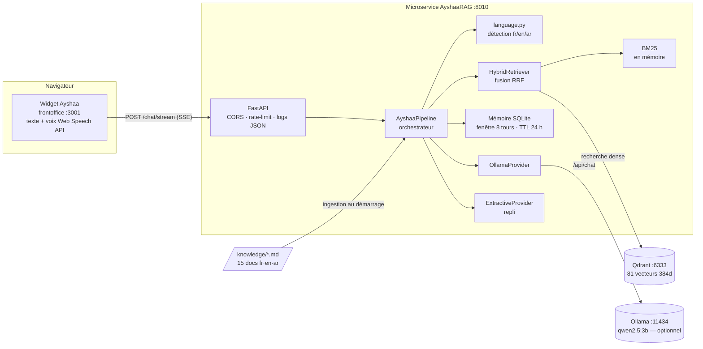

# Architecture d'Ayshaa

## 1. Diagramme global

## 2. Rôle de chaque module

| Module | But | Comment | Communique avec |
|---|---|---|---|
| `api/routes_chat.py` | exposer le chat au widget | REST + SSE, validation Pydantic | pipeline |
| `api/routes_admin.py` | opérations d'exploitation | réindexation à chaud, stats — clé X-Admin-Key | pipeline |
| `api/routes_system.py` | sondes | /health par composant, /metrics Prometheus | pipeline |
| `core/logging.py` | observabilité | JSON 1 ligne/événement, jamais le texte utilisateur | tous |
| `core/ratelimit.py` | anti-abus | fenêtre glissante 30 req/min/IP sur /chat* | middleware |
| `core/security.py` | protection | clé admin (comparaison temps constant) + en-têtes sécurité | routes admin |
| `rag/language.py` | router la langue | écriture arabe → ar ; lexique darija romanisée ; mots-outils fr/en | pipeline |
| `rag/chunking.py` | KB → chunks | front-matter + découpe par titres + re-découpe avec chevauchement | pipeline (ingestion) |
| `rag/embeddings.py` | texte → vecteur | fastembed ONNX 384d, chargement paresseux, échec non fatal | retriever, pipeline |
| `rag/vectorstore.py` | persistance vectorielle | collection Qdrant, filtre par langue, upsert par lots | retriever |
| `rag/lexical.py` | rappel lexical | BM25 en mémoire, normalisation arabe (hamza, tatweel, diacritiques) | retriever |
| `rag/retriever.py` | trouver les passages | dense + BM25 → fusion RRF, élargissement si rappel faible | pipeline |
| `rag/memory.py` | contexte conversationnel | SQLite, fenêtre glissante, purge TTL | pipeline |
| `rag/prompts.py` | qualité des réponses | persona Ayshaa, règle « contexte uniquement », gabarits trilingues | providers |
| `rag/providers.py` | génération | Ollama (streaming, circuit-breaker 30 s) ou extractif | pipeline |
| `rag/pipeline.py` | orchestration | assemble tout, métriques, logs | api |

## 3. Flux de données

1. **Ingestion (démarrage / réindexation)** :
   `knowledge/*.md` → parsing front-matter → chunks (~81) → embeddings 384d →
   Qdrant (payload : lang, topic, audience) + index BM25 en mémoire.
2. **Question** :
   widget → API → détection langue → retrieval hybride (filtre langue,
   élargissement si < 3 résultats) → contrôle de confiance (preuve BM25 ou
   cosinus ≥ 0.45) → génération (Ollama sinon extractif) → mémoire → SSE.
3. **Observabilité** : chaque réponse émet un log JSON
   (`lang, provider, latency_ms, sources`) et incrémente les métriques.

## 4. Choix d'architecture clés

Voir [decisions.md](decisions.md) pour le détail. En résumé :
- **Microservice séparé** : aucun couplage avec les autres services XPARK —
  seule la KB décrit le produit ; déployable/scalable indépendamment.
- **Dégradation gracieuse à tous les étages** : sans Ollama → extractif ;
  sans modèle d'embeddings → BM25 seul ; sans Qdrant → BM25 seul.
  Le service ne renvoie jamais d'erreur à l'utilisateur pour une dépendance.
- **Trilinguisme par la donnée** : la KB existe dans les 3 langues, le
  retrieval filtre par langue — plus fiable qu'une traduction à la volée.
