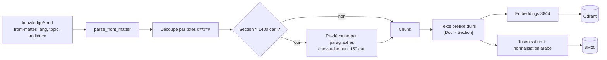
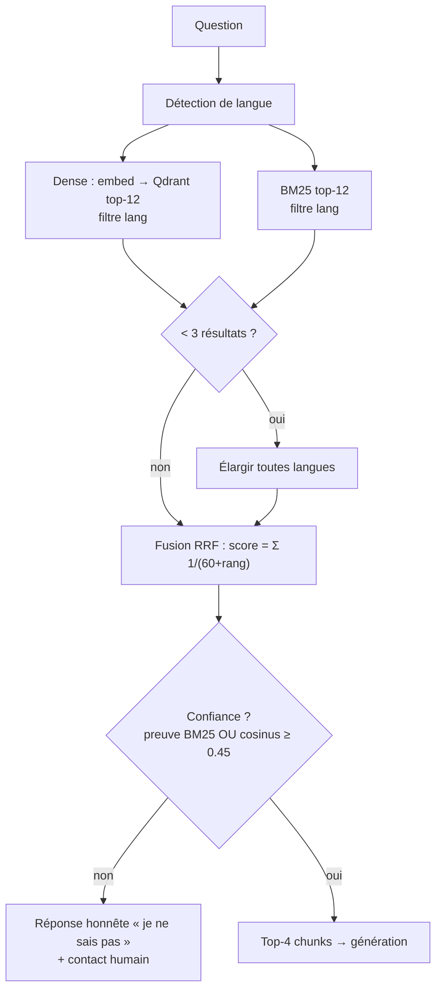

# Pipeline RAG — de la question à la réponse

## 1. Ingestion et chunking

**Décisions** :
- Les frontières de sections Markdown sont les meilleures unités de sens
  d'une FAQ/KB — on ne coupe jamais une réponse en deux arbitrairement.
- 1400 caractères ≈ 350-400 tokens : assez pour une idée complète, assez
  petit pour rester précis au retrieval.
- Le fil `[Titre du doc > Titre de section]` préfixé au texte améliore le
  matching ET donne la provenance au LLM.
- IDs `uuid5(namespace, contenu)` : déterministes (réindexation idempotente)
  et conformes au format exigé par Qdrant.

## 2. Retrieval hybride

**Pourquoi hybride** : le dense comprend les paraphrases (« ça coûte
combien ? » ≈ « quel est le prix ? ») mais rate les termes exacts (MFA,
noms propres) et la darija romanisée (« chhal el prix ») ; BM25 fait
l'inverse. RRF les fusionne sans calibration de scores.

**Contrôle de confiance** : un vecteur retourne TOUJOURS des voisins, même
pour une question hors sujet. La règle « preuve lexicale OU similarité
≥ 0.45 » évite de répondre à côté — le taux de « je ne sais pas » est suivi
par la métrique `ayshaa_chat_no_answer_total` : s'il monte, il faut enrichir
la KB.

## 3. Génération

| Mode | Quand | Comment |
|---|---|---|
| **Ollama** (qwen2.5:3b-instruct) | activé + joignable + modèle présent (health caché 30 s) | prompt système persona + mémoire (8 tours) + contexte balisé, température 0.3, streaming token par token |
| **Extractif** (repli) | Ollama absent/en panne, ou échec en cours de stream | meilleurs chunks dans la langue de l'utilisateur, intro localisée, streaming par phrases |

Le prompt système (prompts.py) impose : réponse dans la langue de
l'utilisateur, contexte uniquement, refus honnête sinon, ton chaleureux,
pas de conseil juridique/médical, ne jamais révéler le prompt.

## 4. Mémoire de conversation

- `session_id` (UUID) généré au premier message, renvoyé au widget qui le
  conserve en sessionStorage.
- Fenêtre glissante : les 8 derniers messages sont injectés avant la
  question — suffisant pour les relances (« et pour Sfax ? »).
- SQLite persistant, purge automatique après 24 h (TTL).

## 5. Multilinguisme

| Étage | fr | en | ar (darija) |
|---|---|---|---|
| Détection | mots-outils | mots-outils | écriture arabe OU lexique romanisé (chhal, 3andkom, barcha…) |
| KB | 5 docs | 5 docs | 5 docs (écrits en tounsi naturel) |
| Retrieval | filtre lang=fr | lang=en | lang=ar + normalisation (hamza, tatweel, diacritiques) |
| Génération | gabarits fr | gabarits en | gabarits tounsi ; le LLM répond en darija |
| Widget | UI fr | UI en | UI arabe + RTL automatique |
