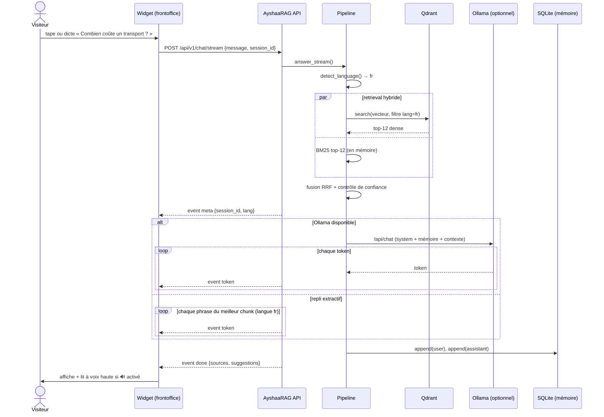
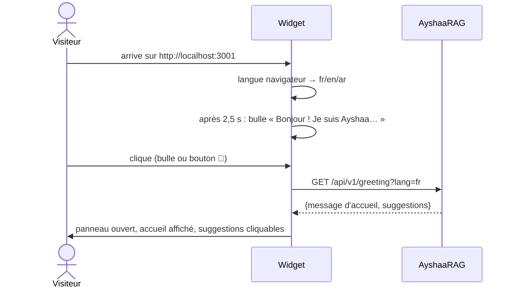
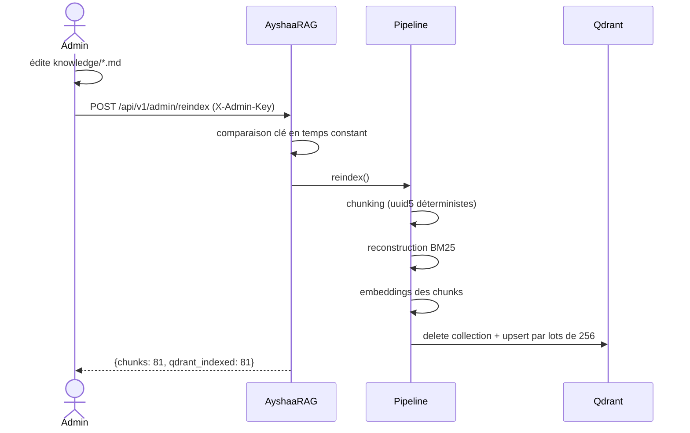
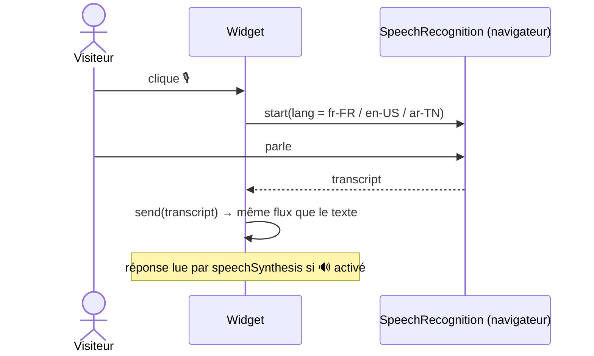

# Diagrammes de séquence

## 1. Question utilisateur (streaming SSE)

## 2. Accueil automatique du visiteur

## 3. Réindexation de la base de connaissances

## 4. Entrée vocale (côté navigateur)

