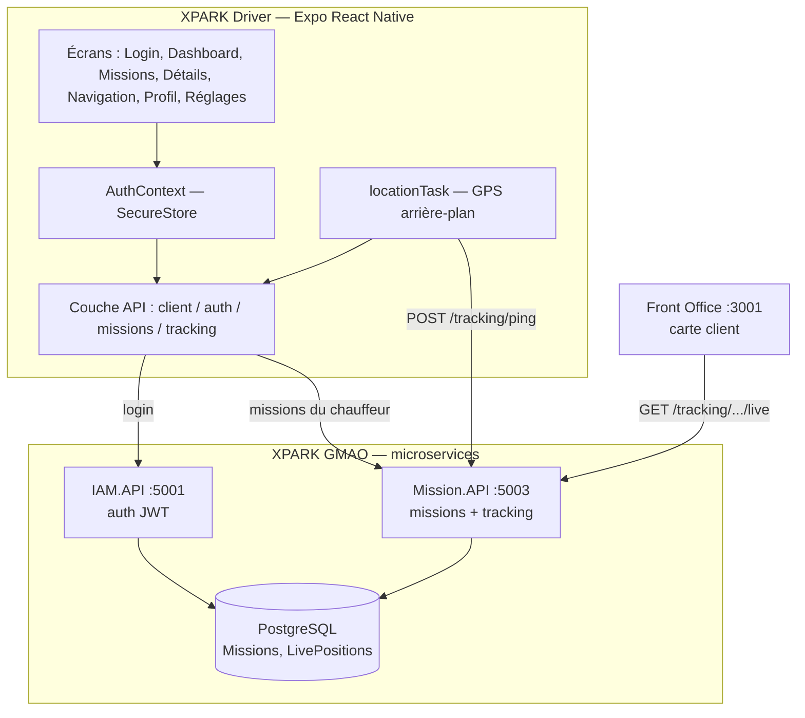

# Architecture — XPARK Driver

## 1. Vue d'ensemble

XPARK Driver est un **module de l'écosystème XPARK GMAO**, pas une app isolée.
Elle réutilise les mêmes services backend que le Front Office et le Back Office.



## 2. Flux de données principal (suivi temps réel)

1. Le chauffeur ouvre une mission et appuie sur **Démarrer la mission**.
2. `locationTask` obtient les permissions puis lance des mises à jour GPS
   (premier plan **et** arrière-plan).
3. À chaque position, un `POST /api/tracking/ping` est envoyé à Mission.API
   avec latitude, longitude, vitesse, cap, précision, horodatage.
4. Mission.API insère la position dans la table `LivePositions`.
5. Le Front Office client interroge `GET /api/tracking/mission/{id}/live` toutes
   les 5 s ; si la position est « fraîche » (< 60 s), la carte affiche le camion
   à sa **vraie** position (sinon, simulation de secours).

## 3. Couches de l'application

| Couche | Dossier | Rôle |
|---|---|---|
| Présentation | `app/` | Écrans (Expo Router, routage par fichiers) |
| UI partagée | `src/components/` | Boutons, cartes, entête, badges |
| Thème | `src/theme/` | Identité visuelle XPARK (couleurs, espacements) |
| Session | `src/auth/` | AuthContext + stockage sécurisé du jeton |
| Accès données | `src/api/` | Client HTTP + endpoints auth/missions/tracking |
| Suivi GPS | `src/tracking/` | Tâche d'arrière-plan, villes, itinéraire OSRM |
| État | `src/hooks/` | `useMissions` (chargement + rechargement) |
| Contrats | `src/types/` | Types TypeScript alignés sur les DTO backend |

## 4. Pourquoi cette séparation

- **Testabilité** : la couche `api/` et `tracking/` ne dépendent pas de React,
  elles sont réutilisables et vérifiables isolément.
- **Évolutivité** : brancher un vrai boîtier GPS ou un transport SignalR ne
  touche que `src/tracking/` (voir [future.md](07-future.md)).
- **Cohérence d'écosystème** : le thème et les types miroir du backend
  garantissent que l'app « fait partie » de XPARK.

## 5. Navigation (routage)

Expo Router = routage par fichiers (comme Next.js, déjà maîtrisé côté Front
Office) :

```
app/_layout.tsx        → provider de session + pile
app/index.tsx          → redirige selon l'authentification
app/login.tsx          → connexion
app/(tabs)/_layout.tsx → 4 onglets (garde d'auth)
app/(tabs)/index.tsx   → Dashboard
app/(tabs)/missions.tsx, profile.tsx, settings.tsx
app/mission/[id].tsx   → détails d'une mission
app/navigation/[id].tsx→ carte + GPS
```
