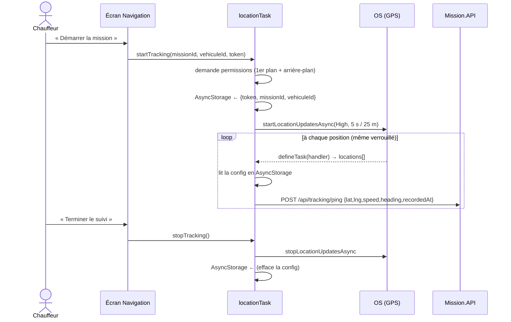

# Suivi GPS temps réel — le cœur de XPARK Driver

Fichier clé : `src/tracking/locationTask.ts`.

## 1. Ce que ça fait

Pendant une mission active, le téléphone envoie sa position au backend XPARK
**en continu**, y compris quand l'app est en arrière-plan ou l'écran verrouillé.
Données envoyées à chaque point : latitude, longitude, vitesse, cap (direction),
précision, horodatage.

## 2. Pourquoi une tâche d'arrière-plan

Un chauffeur ne garde pas l'app ouverte au premier plan en conduisant. Un simple
`watchPositionAsync` s'arrête en arrière-plan. On utilise donc :
- `Location.startLocationUpdatesAsync(TASK, options)` — démarre un flux de
  positions géré par l'OS ;
- `TaskManager.defineTask(TASK, handler)` — le handler est appelé par l'OS à
  chaque lot de positions, **même app fermée en arrière-plan** ;
- un **foreground service** Android (notification persistante) + `UIBackgroundModes:
  location` iOS pour que l'OS autorise le suivi continu.

## 3. Comment ça marche (détaillé)



**Point subtil** : la tâche s'exécute dans un contexte séparé du React (pas
d'accès au state ni au contexte d'auth). C'est pourquoi la configuration active
(jeton, mission, véhicule) est **persistée en AsyncStorage** au démarrage du
suivi et **relue par la tâche** à chaque position.

## 4. Robustesse

- Un `ping` qui échoue (réseau mobile coupé) **n'arrête pas** le suivi :
  `sendPing` avale l'erreur et journalise. Les positions suivantes repartiront.
- La permission « arrière-plan » peut être refusée : le suivi fonctionne alors
  au premier plan uniquement (dégradation gracieuse, pas de crash).
- `stopTracking` est aussi appelé à la déconnexion (`AuthContext.signOut`).

## 5. Paramètres (configurables)

Dans `.env` (voir `.env.example`) :

| Variable | Défaut | Rôle |
|---|---|---|
| `EXPO_PUBLIC_PING_INTERVAL_SEC` | `5` | intervalle minimal entre positions (s) |
| `EXPO_PUBLIC_PING_DISTANCE_M` | `25` | distance minimale entre positions (m) |

Compromis fraîcheur/batterie : plus court = plus fluide côté client mais plus de
batterie et de data. 5 s / 25 m est un bon équilibre pour du transport routier.

## 6. Données envoyées

`POST /api/tracking/ping` (voir [backend-integration.md](05-backend-integration.md)) :

```json
{
  "missionId": 28,
  "vehiculeId": 15,
  "latitude": 36.05,
  "longitude": 10.52,
  "speedKmh": 70.2,
  "heading": 160,
  "accuracy": 8,
  "recordedAt": "2026-07-11T12:00:00.000Z"
}
```

## 7. Comment tester

1. Sur l'écran **Navigation** d'une mission, accorder la localisation.
2. Appuyer **Démarrer la mission** → bandeau « Suivi actif ».
3. Se déplacer (ou simuler un trajet avec l'émulateur : Android Studio →
   Extended controls → Location → route playback).
4. Vérifier côté backend :
   `GET http://<serveur>:5003/api/tracking/mission/28/live` → renvoie la dernière
   position avec `isFresh: true`.
5. Ouvrir le Front Office client `/account/tracking` de la mission → le camion
   s'affiche à la **vraie** position (badge « GPS en direct »).

## 8. Évolutions

Voir [future.md](07-future.md) : SignalR (push au lieu de polling), file d'attente
locale des positions hors-ligne (rejeu à la reconnexion), boîtier GPS véhicule.
